# 小新与哆啦A梦手办建模参考

包含最新整体正面图及 24 张独立局部细节图。

## 整体图

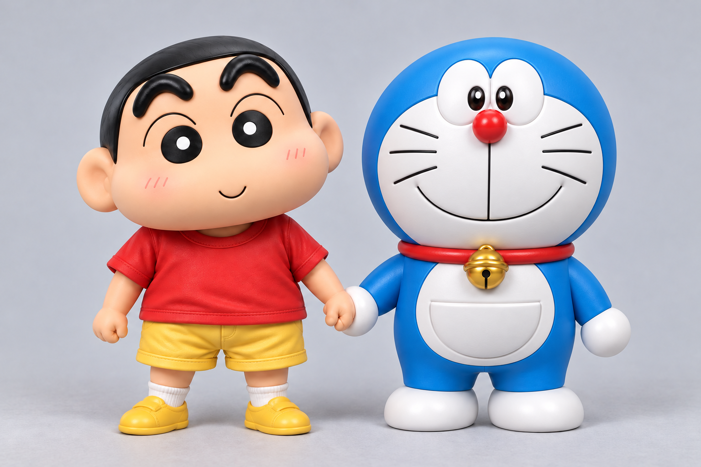

## 独立细节图

细节图保存在 `独立细节图/`，涵盖头部、五官、服装、鞋袜、牵手、铃铛、项圈、口袋和手脚。

局部图依据整体图生成，可能存在细微造型差异；建模比例以整体图为准。独立图片约为 488 × 488 像素，源自六格参考板拆分。

### 01_小新_完整头部

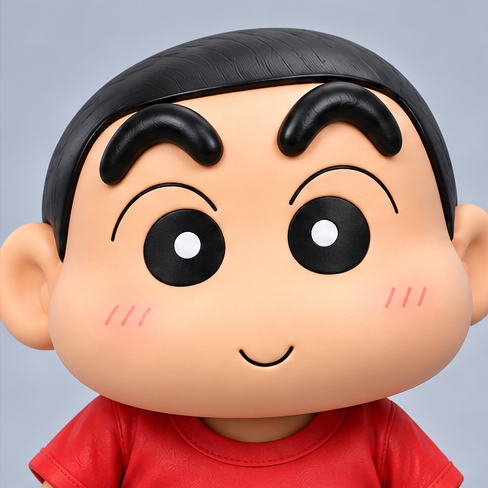

### 02_小新_眉毛眼睛

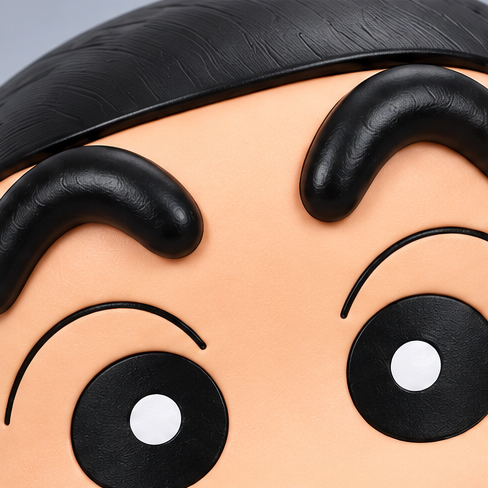

### 03_小新_嘴部下巴

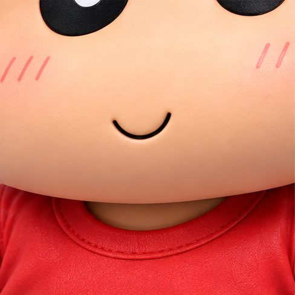

### 04_小新_耳廓头发

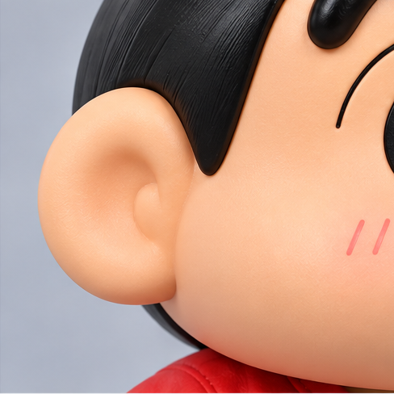

### 05_小新_衣领袖口

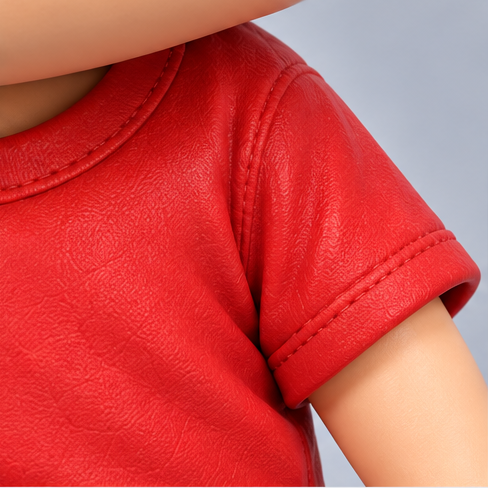

### 06_小新_衣摆短裤

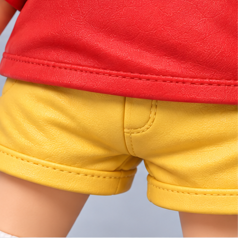

### 07_哆啦A梦_完整头部

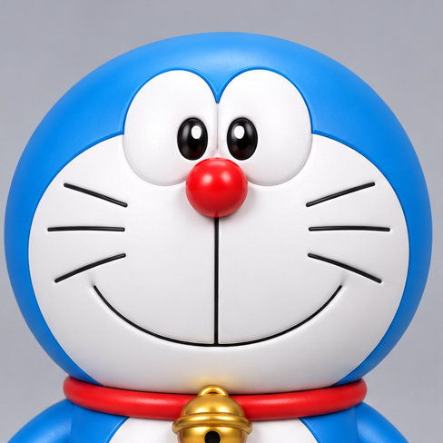

### 08_哆啦A梦_眼睛

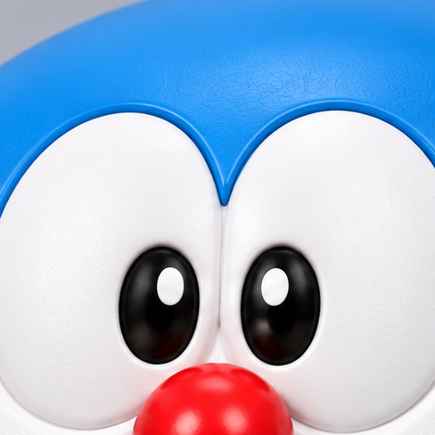

### 09_哆啦A梦_鼻子

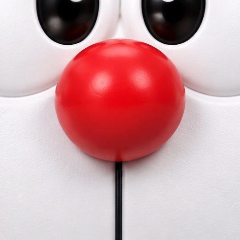

### 10_哆啦A梦_嘴部下巴

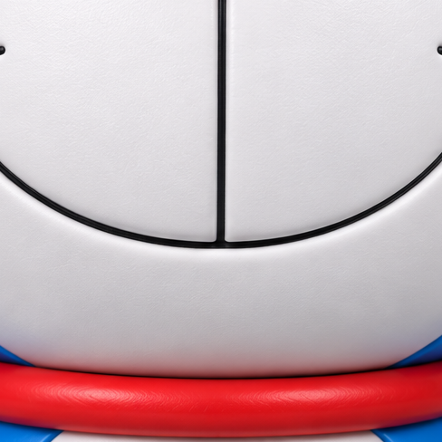

### 11_哆啦A梦_胡须

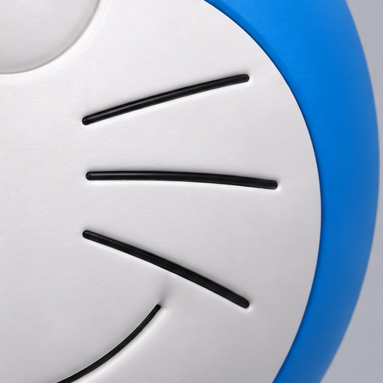

### 12_哆啦A梦_项圈连接

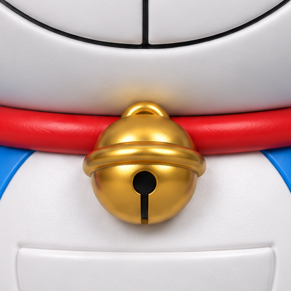

### 13_哆啦A梦_铃铛正面

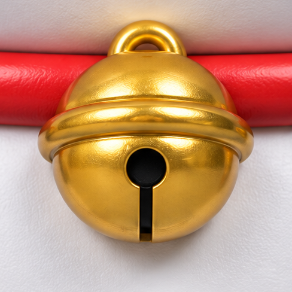

### 14_哆啦A梦_铃铛侧面

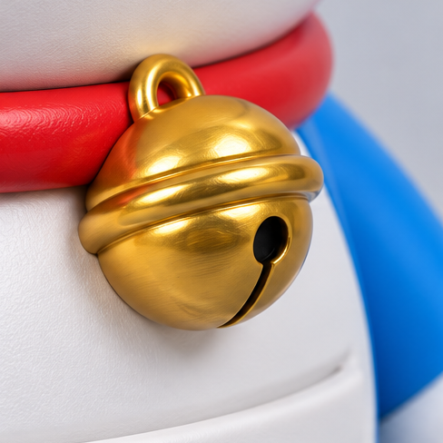

### 15_哆啦A梦_腹部口袋

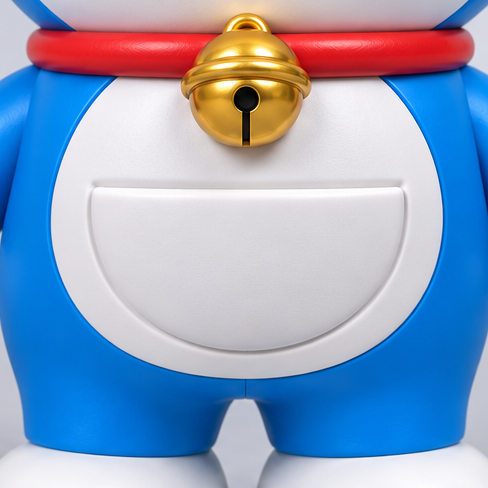

### 16_哆啦A梦_口袋边缘

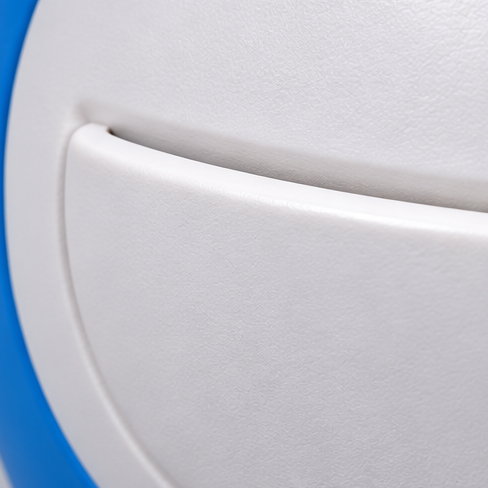

### 17_哆啦A梦_手臂球手

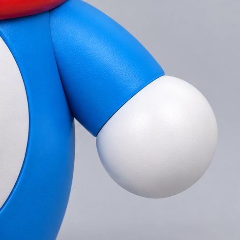

### 18_哆啦A梦_双脚

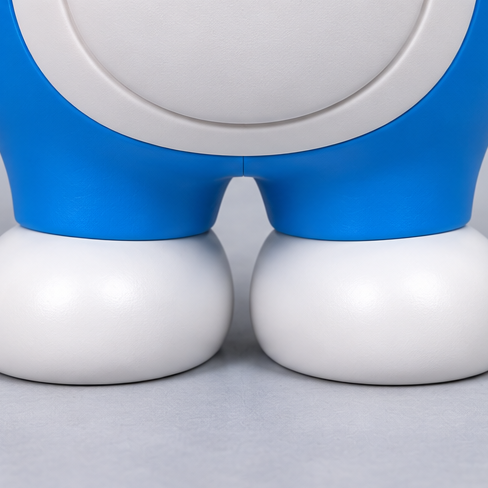

### 19_牵手_正面

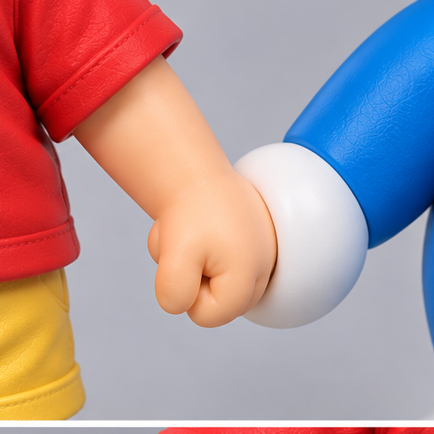

### 20_牵手_接触细节

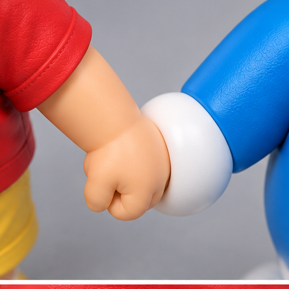

### 21_牵手_双臂姿态

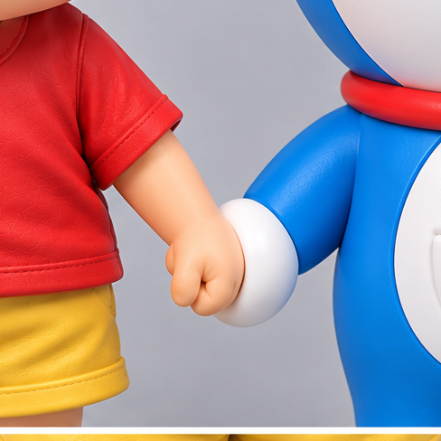

### 22_小新_外侧手

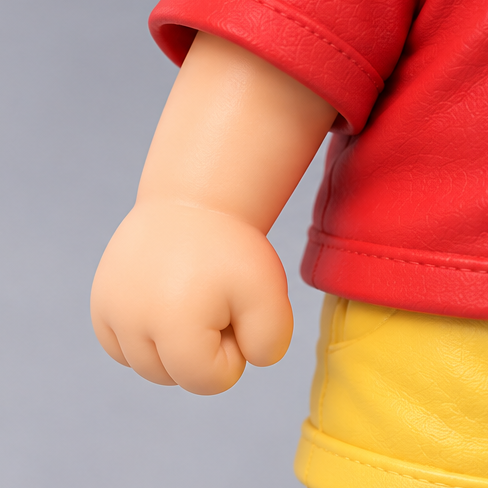

### 23_小新_短裤

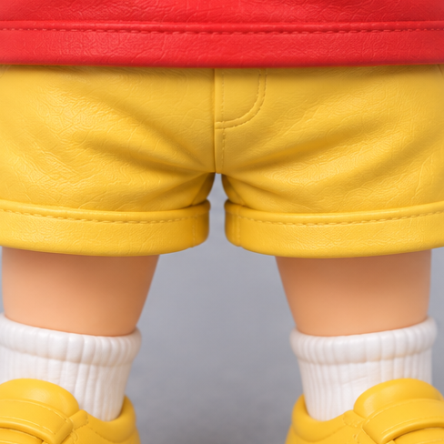

### 24_小新_鞋袜

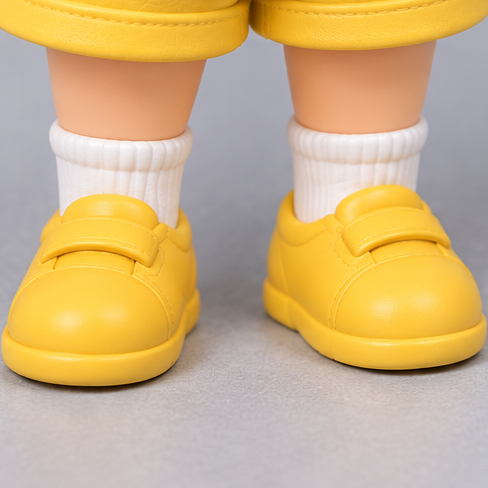

